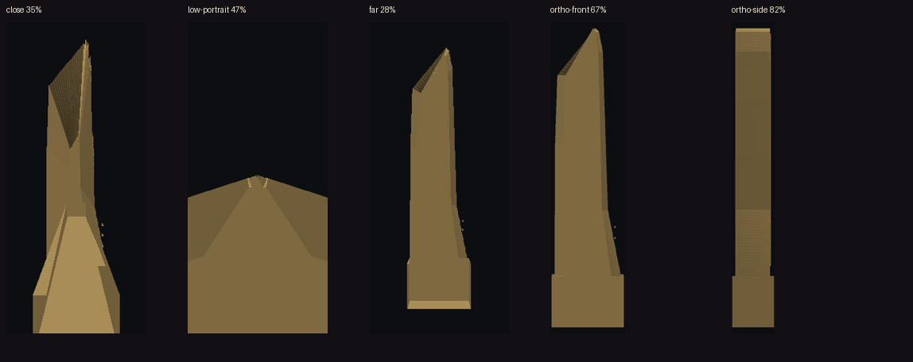

# Foundation pass — 11 Oct

Verdict: PASS

Shared tools only. No Imagine images. The live preview was not opened or edited. Weights stay in `/workspace/models/vision` (not in git).

## 1. Models on disk

`python3 tools/common/vision_models.py status` (bytes match the catalog):

| Model | File | Bytes | Ready |
| --- | --- | --- | --- |
| Depth Anything V2 Large | `depth_anything_v2_vitl.pth` | 1,341,395,338 | yes |
| MoGe-2 vitl | `moge-2-vitl.pt` | 1,305,030,700 | yes |
| SAM 2.1 small | `sam2.1_hiera_small.pt` | 184,416,285 | yes |
| SAM 2.1 base+ | `sam2.1_hiera_base_plus.pt` | 323,606,802 | yes |

Free space at status time: 11,132,260,352 bytes. Relief and fuse still use Depth Anything V2 Small (`load_depth_session`).

## 2. Cache demo

One 96×128 image, each model twice. `hit1` is false, `hit2` is true, the arrays match.

| Model | Shape | First call (s) | Cache hit (s) | Same |
| --- | --- | --- | --- | --- |
| sam2-small | 128×96 | 2.3525 | 0.0003 | yes |
| sam2-base | 128×96 | 3.0657 | 0.0004 | yes |
| dav2-large | 128×96 | 7.5798 | 0.0011 | yes |
| moge-2 | 128×96 | 10.5613 | 0.0002 | yes |

Demo input size is small on purpose (DAV2 side 280 requested, MoGe side 192). The returned maps are the model outputs, not stand-ins.

## 3. Loading-screen captures

`node tools/common/render_harness.mjs steps/foundation-1011` on a local fixture. Both frames are 412×915.

| Shot | Result |
| --- | --- |
| Before (400 ms, overlay still up) | FAIL — loading screen. DOM text `Chargement… 17/20`. |
| After (overlay hidden, `__sceneReady`) | PASS |

The object gate waits for that overlay to leave (`waitSceneReady`) and records `capture ready`.

## 4. Fusion tower checklist

GLB `/workspace/i23d-auto/zoneb-tower-vision/vision/tower.glb`. Software raster, same `frame_bbox` math. Front is +Z. Cover is measured pixels.

| View | Distance | Cover | Gate |
| --- | --- | --- | --- |
| close | 8 m | 35.31% | PASS (≥ 25%) |
| low-portrait | 8 m, eye 1.6 m | 47.29% | PASS (≥ 25%) |
| far | 461.6 m | 27.64% | PASS (≥ 25%) |
| ortho-front | face | 67.24% | PASS (≥ 60%, not black) |
| ortho-side | face | 82.06% | PASS (≥ 60%, not black) |

## 5. Selftests

- `python3 tools/common/selftest.py` — PASS
- `node tools/object-gate/selftest.mjs` — PASS (API 1.7, check ids unique)

Cheap clock: silhouette then colour, minimum IoU 0.87, maximum colour mean-abs 0.12. `heavy()` before a cheap pass raises `StageOrderError`.

Doc: [docs/METHOD/foundation-tools.md](docs/METHOD/foundation-tools.md).
